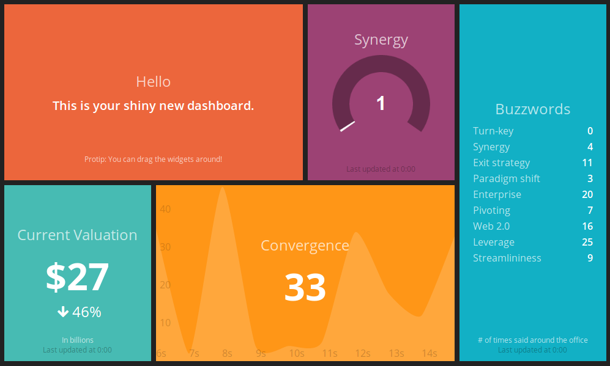

[](https://github.com/Smashing/smashing/actions/workflows/main.yml)
[](https://gitter.im/Smashing)

# [Smashing](https://github.com/Smashing/smashing/wiki)

Smashing, the spiritual successor to [Dashing](https://github.com/Shopify/dashing), is a Sinatra based framework that lets you build excellent dashboards. It looks especially great on TVs.




## Installation

```bash
# Install bundler
$ gem install bundler
# Install smashing
$ gem install smashing
# Create a new project
$ smashing new my-project
# Change Directory into the project
$ cd my-project
# Install the bundle of project specific gems
$ bundle
# Start the example dashboard!
$ smashing start
```


Note: This is a fork of the Dashing project, which is no longer being maintained. Read about that [here](https://github.com/Shopify/dashing/issues/711).


